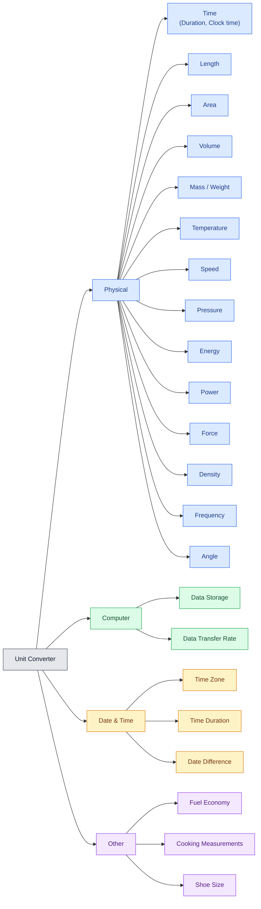

# Unit Converter

A React + TypeScript web app for unit conversion. Pick a category from the grid and it opens in a dialog.

**Live:** <https://Aniruddha-25.github.io/unit-convertor/>

## Converters

Currently available: **Time** (Duration, Clock time) and **Time Zone**. All others are coming soon.



> Source of truth: [src/config/categories.ts](src/config/categories.ts)

### Adding a converter

1. Add or update the category in `src/config/categories.ts` (set `status: 'available'` and attach a `converter`).
2. Update the diagram above: add a node under its group and list it in the matching `class` line.

## Tech Stack

- React 19 + TypeScript
- Vite
- `@js-temporal/polyfill` (time zones and DST)
- ESLint, Node test runner

## Getting Started

Requires Node.js (CI uses 22).

```bash
git clone https://github.com/Aniruddha-25/unit-convertor.git
cd unit-convertor
npm install
```

| Task             | Command           |
|------------------|-------------------|
| Run locally      | `npm run dev`     |
| Production build | `npm run build`   |
| Preview build    | `npm run preview` |
| Lint             | `npm run lint`    |
| Test             | `npm test`        |

## Deployment

Deployed to GitHub Pages by `.github/workflows/deploy.yml` on every push to `main`.

1. In **Settings → Pages**, set the source to **GitHub Actions**.
2. Push to `main`.

The Vite base path is `/unit-convertor/` ([vite.config.ts](vite.config.ts)). Update it if the repository is renamed.

## Contributing

Fork, create a branch, run `npm run lint` and `npm test`, then open a pull request.

## License

No license file is included yet.
