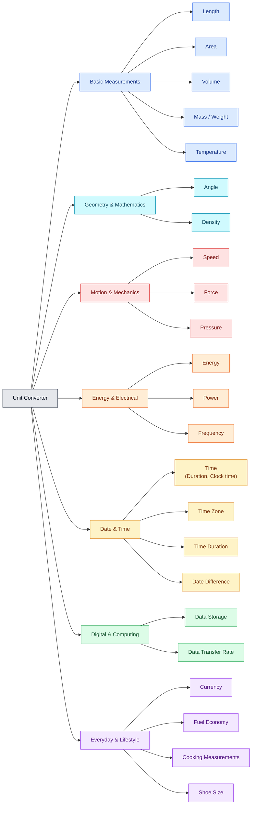

# Unit Converter

A React + TypeScript web app for unit conversion. Pick a category from the grid and it opens in a dialog.

**Live:** <https://Aniruddha-25.github.io/unit-convertor/>

## Converters




## Tech Stack

- React 19 + TypeScript
- Vite
- ESLint, Node test runner

## Getting Started

```bash
git clone https://github.com/Aniruddha-25/unit-convertor.git
```

```bash
npm install
```

| Task             | Command           |
|------------------|-------------------|
| Run locally      | `npm run dev`     |
| Production build | `npm run build`   |
| Preview build    | `npm run preview` |
| Lint             | `npm run lint`    |
| Test             | `npm test`        |

## Deployment

Deployed to GitHub Pages by `.github/workflows/deploy.yml` on every push to `main`.

1. In **Settings → Pages**, set the source to **GitHub Actions**.
2. Push to `main`.

The Vite base path is `/unit-convertor/` ([vite.config.ts](vite.config.ts)). Update it if the repository is renamed.